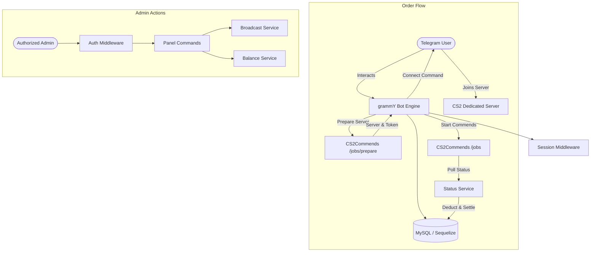

# CommendBot

> Automated Counter-Strike 2 (CS2) commends delivery bot for Telegram, powered by grammY, Sequelize, and the CS2Commends Reseller API.

[](https://nodejs.org/)
[](https://grammy.dev/)
[](https://sequelize.org/)
[](https://www.mysql.com/)
[](LICENSE)

---

## 📌 Overview

**CommendBot** is an asynchronous Telegram bot designed to manage and fulfill CS2 commend orders end-to-end. It features real-time wallet balance tracking, Steam profile input validation, automated server reservation, progress polling, and an administrative panel for customer management and broadcasts.

---

## ✨ Features

### User Features
- **Interactive Menu Interface**: Keyboard-driven navigation with Telegram custom emoji support.
- **Commend Ordering Pipeline**:
  - Validates requested quantity and checks available wallet funds.
  - Verifies Steam profile URLs or numeric SteamIDs.
  - Automatically requests dedicated game server allocation via `POST /api/jobs/prepare`.
  - Dispatches one-click `connect` console commands for players to join.
- **Real-Time Job Polling**: Checks delivery progress every 30 seconds (`/api/jobs/:id`) and updates users until all commends land.
- **Account Summary**: Live balance, total commends delivered, and unique user ID overview.

### Admin Capabilities
- **Role-Based Access Control**: Strict Telegram user ID whitelisting middleware.
- **Balance Top-Up**: Credit user accounts directly from chat with automatic customer notifications.
- **User Directory**: View all registered users, usernames, and balances in a structured list.
- **Global Announcements**: Broadcast messages to all registered bot users with cancellation support.

### System & Infrastructure
- **PaaS / Cloud Ready**: Integrated lightweight HTTP health-check server on port 3000 to satisfy Kubernetes and PaaS container liveness probes.
- **Resilient API Handling**: Comprehensive error trapping with user-facing alerts and documented error code resolution.
- **Modular Architecture**: Complete separation of routes, keyboard layouts, database models, and external API services.

---

## 🏗 Architecture & Flow



---

## 📁 Project Structure

```
commendbot/
├── command/
│   ├── panel.js            # Admin management commands
│   └── start.js            # /start handler and registration
├── models/
│   ├── products.js         # Order / product schema definition
│   └── users.js            # User profile and balance schema
├── routes/
│   ├── buy.js              # Purchase information and pricing
│   └── buyHandler.js       # Purchase state machine and message router
├── services/
│   ├── getServer.js        # Server reservation endpoint integration
│   ├── getStatus.js        # Periodic delivery poller and balance settlement
│   ├── startCommend.js     # Job dispatch with idempotency protection
│   └── user.js             # User account and balance mutation helpers
├── app.js                  # Main entry point and HTTP health-check server
├── auth.js                 # Admin authorization middleware
├── database.js             # Sequelize database instance and connection pool
├── keyboards.js            # Reusable inline and reply keyboards
└── package.json            # Node.js project manifest and scripts
```

---

## 🚀 Getting Started

### Prerequisites
- **Node.js** (v18.0.0 or higher, v20/v24 recommended)
- **MySQL** (v8.0 or v9.x)
- **Telegram Bot Token** (obtained from [@BotFather](https://t.me/BotFather))
- **CS2Commends Reseller API Key**

### Installation

1. Clone the repository:
   ```bash
   git clone https://github.com/your-username/commendbot.git
   cd commendbot
   ```

2. Install project dependencies:
   ```bash
   npm install
   ```

3. Create your `.env` configuration file in the project root:
   ```env
   # Telegram Bot Configuration
   TOKEN=1234567890:ABCdefGHIjklMNOpqrSTUvwxYZ

   # CS2Commends Reseller API
   API_KEY=rsk_live_xxxxxxxxxxxxxxxxxxxxxxxxxxxx

   # Database Connection
   DB_HOST=localhost
   DB_PORT=3306
   DB_NAME=commendbot
   DB_USER=root
   DB_PASSWORD=your_secure_password

   # Web Server (Optional, defaults to 3000)
   PORT=3000
   ```

4. Configure administrator IDs in `auth.js`:
   ```javascript
   const adminList = ["YOUR_TELEGRAM_USER_ID"];
   ```

---

## 💻 Running the Application

### Development Mode
Runs the application with automatic restarts via `nodemon`:
```bash
npm run dev
```

### Production Mode
Executes the main entry point:
```bash
npm start
```

---

## ☁️ Deployment

### Cloud & PaaS (ParsPack, Liara, Heroku, OpenShift)
The project is built specifically to deploy seamlessly on containerized PaaS platforms:

1. **Port Binding**: An embedded HTTP server listens on `process.env.PORT || 3000`. The container responds with `200 OK` on root HTTP requests to prevent container restart loops (`CrashLoopBackOff`).
2. **Database Networking**: Set `DB_HOST` to your database service name (e.g. `app-mysql-xxxxx` when hosted within the same project namespace).
3. **Environment Variables**: Configure all secrets through your cloud provider's environment variables dashboard rather than committing `.env`.
4. **Server Location**: Ensure your server container is deployed to a European or international data center so outgoing connections to Telegram's Bot API (`api.telegram.org`) are not restricted.

---

## 🔒 Security Best Practices

- Never commit `.env` or sensitive credentials to source control.
- Restrict admin panel commands to verified Telegram user IDs in `auth.js`.
- Use least-privilege MySQL user accounts (`client`) instead of `root` in production environments.

---

## 📄 License

This project is licensed under the [ISC License](LICENSE).

